# Cytoscape.js - Combined Legacy System Characteristics

**Group:** Two Brain Cells  
**Compiled by:** Zaky Muhammad Hasyim (24051682)  
**Source:** Tutorial 4_5 Updated 2.pdf  
**Scope:** Cytoscape.js 3.34.4 baseline and documented group changes  
**Status:** Proposed findings for group review; evidence compilation updated 17 November 2026

## Introduction

Cytoscape.js remains actively maintained, but the group identified several areas that require careful maintenance. The following five characteristics combine overlapping individual findings while keeping their supporting evidence and maintenance implications clear. They describe specific components and development processes rather than labelling the entire library obsolete.

## Proposed Improvement Ranking

This order reflects demonstrated scope and benefit in the supplied report, not measured performance or an objective severity score. The group should confirm the order.

| Rank | Contributor and change | Reason for position | Change link and status |
|---|---|---|---|
| 1 | Anes — dependency upgrades and benchmark downloader replacement | Broad development-tool impact and reported audit reduction from 27 to 21; affected commands were checked. Findings remained after the changes. | [Tool upgrade commit](https://github.com/Anesbad/cytoscape.js/commit/f39a0ac0); [downloader replacement commit](https://github.com/Anesbad/cytoscape.js/commit/b55d7f39). Commit identifiers supplied in PDF; live accessibility and PR review status not checked. |
| 2 | Keertti — Grid dimension validation | Corrects documented invalid node positions for zero dimensions, with targeted regression checks. | [PR #2 — Files changed](https://github.com/Anesbad/cytoscape.js/pull/2/files); [commit b13c33eee](https://github.com/Anesbad/cytoscape.js/commit/b13c33eee). References supplied in PDF; live status not checked. |
| 3 | Sanchay — pin GitHub Actions runner to Ubuntu 24.04 | Addresses a reported browser-installation blocker in CI. The reported remote success and local lint failure need revision-specific clarification. | [PR #1 — Files changed](https://github.com/Anesbad/cytoscape.js/pull/1/files). Reference supplied in PDF; live status not checked. |
| 4 | Saufi — connected-edge restoration regression test | Adds focused protection for an established operation sequence without a documented production-code change. | [PR #7 — Files changed](https://github.com/Anesbad/cytoscape.js/pull/7/files). PDF reports reviewed, merged and checks passing; live status not checked. |
| 5 | Jasmine — Promise selection documentation | Clarifies an existing compatibility mechanism. Targeted checks passed; no functional bug fix is claimed. | Exact PR/commit diff is not supplied in the PDF. [Current source](https://github.com/Anesbad/cytoscape.js/blob/wif3005-demo/src/promise.mjs) is context, not proof of the change. |
| Pending | Yashveena — more precise style declarations | Investigation is documented, but a completed change and before/after compiler results are not supplied. It is not ranked as a completed improvement. | [Current type declarations](https://github.com/Anesbad/cytoscape.js/blob/wif3005-demo/index.d.ts). Exact change link and compiler evidence pending. |

Zaky's contribution is the evidence synthesis and repository summary; it is not counted as an additional functional improvement. Veronica's related findings are incorporated, but a separate completed evidence-refinement change is not established by this PDF.

## Combined Legacy System Characteristics

| Characteristic | Meaning in our own words | Specific Cytoscape.js example | Repository evidence | Why it matters for maintenance or future changes |
|---|---|---|---|---|
| **1. Deprecated development dependencies** | A project may continue using development tools whose older versions are no longer supported. Updating them can require changes to commands and related dependencies. | Anes documented baseline rimraf and gh-pages dependency paths involving deprecated glob and inflight packages. He upgraded the tools and separately replaced the benchmark downloader. | `package.json`, `package-lock.json` and `benchmark/download.mjs`; documented commits `f39a0ac0` and `b55d7f39`. | Maintainers should trace dependency paths and verify affected commands after upgrades. Updating one tool does not necessarily remove every deprecated dependency or audit finding. |
| **2. Gaps in regression coverage for established behaviour** | Existing tests may omit particular inputs or sequences of operations, leaving those cases less protected during maintenance. | Keertti documented invalid Grid positions with zero dimensions and added validation and regression tests. Saufi extended a specific node-restoration test scenario by adding a case that restores a node and then its connected edge, checking the edge's endpoints. | `src/extensions/layout/grid.mjs`, `test/layout-grid.mjs` and `test/collection-graph-manipulation.mjs`; [PR #2](https://github.com/Anesbad/cytoscape.js/pull/2) and [PR #7](https://github.com/Anesbad/cytoscape.js/pull/7). | Targeted tests protect unusual inputs and operation sequences during future changes. These findings identify specific cases; they do not establish that the project lacks regression testing overall. |
| **3. Older configurations and environment compatibility** | Older configurations and broad runtime declarations can remain alongside newer development environments. Their purposes and compatibility need investigation. | `.travis.yml` lists Node.js 10 and 12, `.nvmrc` specifies Node.js 24, and `package.json` declares Node.js `>=0.10`. Sanchay also documented a CI runner compatibility issue and changed GitHub Actions to Ubuntu 24.04. | `.travis.yml`, `.nvmrc`, `package.json` and `.github/workflows/tests.yml`; [PR #1](https://github.com/Anesbad/cytoscape.js/pull/1); Zaky's configuration evidence on PDF pages 75–76. | Maintainers must distinguish declared runtime compatibility from the development environment. They should verify configuration usage and workflow results before removing older files or changing support claims. |
| **4. Backward compatibility and multiple implementation paths** | Supporting older environments can require alternative implementations, increasing the code that developers must understand and verify. | `src/promise.mjs` selects native Promise when available and an internal fallback otherwise. Zaky also traced its use in `src/collection/layout.mjs`, where `Promise.all()` waits for animations before `layoutstop` is emitted. | `src/promise.mjs`; `src/collection/layout.mjs`; Jasmine's investigation on PDF pages 21–23 and Zaky's evidence on pages 76–77. | Changes should consider both Promise implementations and their callers. Removing the fallback requires investigating compatibility needs, while changes to shared behaviour should include checks of animation completion and event timing. |
| **5. Overly permissive TypeScript declarations** | A type declaration can be too general to help developers detect incorrect values during compilation. Making it stricter requires compatibility checks. | Yashveena identified `CssStyleDeclaration = any` in `index.d.ts`. The shared type is used by `ElementDefinition.style`, so changing it could affect existing TypeScript consumers. | `index.d.ts` — `CssStyleDeclaration` and `ElementDefinition`; Yashveena's investigation on PDF pages 82–84. | More precise types could catch mistakes earlier, but stricter declarations might reject previously accepted application code. Before-and-after compiler examples are needed to demonstrate the benefit and compatibility impact. |

## Contribution and Verification Summary

The results below are reported by individual contributors in the PDF. They have not been independently rerun as part of this compilation.

| Finding | Contributions combined | Verification and evidence reported |
|---|---|---|
| **Deprecated dependencies** | Anes | Tool and command checks; 759 JavaScript tests passing; audit findings reduced from 27 to 21 after the downloader change. Existing lint and documentation-generation failures were reported separately. |
| **Backward compatibility** | Jasmine's implementation investigation; Zaky's source analysis; related findings from Veronica and Sanchay. | Jasmine reports four targeted Promise checks passing, together with 759 JavaScript tests and 46 module tests before and after documentation comments were added. Zaky traces Promise selection and its use in layout completion. His contribution provides source evidence, not an additional test run. |
| **Configuration and environment compatibility** | Sanchay's practical investigation, supported by related configuration and runtime findings across the group. | Sanchay reports 23 local Playwright tests passing and a successful updated GitHub Actions run. He separately reports that local `npm test` encountered ESLint failures. Zaky's source excerpts document the different configuration settings. |
| **Regression coverage** | Keertti and Saufi | Keertti reports a failing zero-row check before the fix, two targeted checks passing afterwards, and 883 JavaScript tests passing. Saufi reports 761 JavaScript tests before, one new targeted test passing, and 762 afterwards. PR #7 is reported as reviewed and merged. |
| **Type declarations** | Yashveena's investigation; related evidence-review responsibility assigned to Veronica. | The PDF identifies the permissive declaration and a dependent type. It does not document a completed type change, before-and-after compiler results or a PR reference for this finding. |

Test totals belong to each contributor's reported revision, command and environment. They should not be added together or presented as one final integrated test result. Separately reported module results may overlap with a recursive JavaScript test run.

## Repository Evidence

### 1. Deprecated Development Dependencies

Anes's baseline evidence identifies dependency paths from older development tools to deprecated packages. His documented changes upgrade rimraf and gh-pages and replace the benchmark downloader with a Node.js script.

The evidence connects the original dependency issue to specific changes and command checks. However, the reported reduction in audit findings does not mean that every finding was resolved.

**References:** `package.json`, `package-lock.json`, `benchmark/download.mjs`; commits `f39a0ac0` and `b55d7f39`; PDF pages 9–18.

### 2. Promise Compatibility and Dependent Behaviour

The final export in `src/promise.mjs` selects native Promise when available and the internal fallback otherwise. Jasmine's investigation checks selected native and fallback behaviours and documents the reason for retaining the fallback.

Zaky's evidence traces a caller in `src/collection/layout.mjs`. This module waits for animation promises before emitting `layoutstop`, providing a concrete behaviour to consider during impact analysis. This dependency does not by itself demonstrate poor architecture.

**References:** [src/promise.mjs](https://github.com/Anesbad/cytoscape.js/blob/wif3005-demo/src/promise.mjs), [src/collection/layout.mjs](https://github.com/Anesbad/cytoscape.js/blob/wif3005-demo/src/collection/layout.mjs); PDF pages 21–23 and 76–77.

### 3. Configuration and Runtime Evidence

The repository contains different runtime settings: Node.js 10 and 12 in `.travis.yml`, Node.js 24 in `.nvmrc`, and `>=0.10` in the package engine declaration. These settings serve different purposes and do not establish that every declared runtime is currently tested.

Sanchay's practical investigation concerns the GitHub Actions runner environment. It should be distinguished from a claim that Travis remains active or that a complete CI migration has been performed.

**References:** [.travis.yml](https://github.com/Anesbad/cytoscape.js/blob/wif3005-demo/.travis.yml), [.nvmrc](https://github.com/Anesbad/cytoscape.js/blob/wif3005-demo/.nvmrc), [package.json](https://github.com/Anesbad/cytoscape.js/blob/wif3005-demo/package.json), [tests.yml](https://github.com/Anesbad/cytoscape.js/blob/wif3005-demo/.github/workflows/tests.yml), [PR #1](https://github.com/Anesbad/cytoscape.js/pull/1); PDF pages 49–58 and 75–76.

### 4. Regression-Test Evidence

Keertti's investigation connects zero Grid dimensions to invalid node positions and documents a corrective change with regression tests.

Saufi's contribution adds a test that restores a node and then its connected edge, checking that the edge reconnects to the expected endpoints. It extends a specific scenario rather than proving that the whole repository previously lacked related coverage.

**References:** `src/extensions/layout/grid.mjs`, `test/layout-grid.mjs`, `test/collection-graph-manipulation.mjs`; [PR #2](https://github.com/Anesbad/cytoscape.js/pull/2), [PR #7](https://github.com/Anesbad/cytoscape.js/pull/7); PDF pages 28–36 and 59–65.

### 5. TypeScript Declaration Evidence

Yashveena identifies `CssStyleDeclaration = any` and its use by `ElementDefinition.style`. This supports investigating whether a more precise declaration could improve compiler checking.

A concrete example of an incorrect value accepted before a change and rejected afterwards is still needed to demonstrate an implemented improvement. Valid existing examples should also be checked for compatibility.

**Reference:** [index.d.ts](https://github.com/Anesbad/cytoscape.js/blob/wif3005-demo/index.d.ts); PDF pages 82–84.

## Screenshots and Change Evidence

These images are rendered from the supplied PDF, not newly executed tests or newly captured GitHub pages. Captions identify their provenance. Original screenshot resolution limits remain; full-page images retain the surrounding explanation. Upload the `evidence/` folder beside this Markdown file so the relative image links render on GitHub.

### Rank 1 — Anes: dependency and downloader changes

**Changed locations:** `package.json`, `package-lock.json`, `benchmark/download.mjs`.  
**Exact change references:** [f39a0ac0](https://github.com/Anesbad/cytoscape.js/commit/f39a0ac0), [b55d7f39](https://github.com/Anesbad/cytoscape.js/commit/b55d7f39). These are PDF-supplied commit references, not independently checked live.

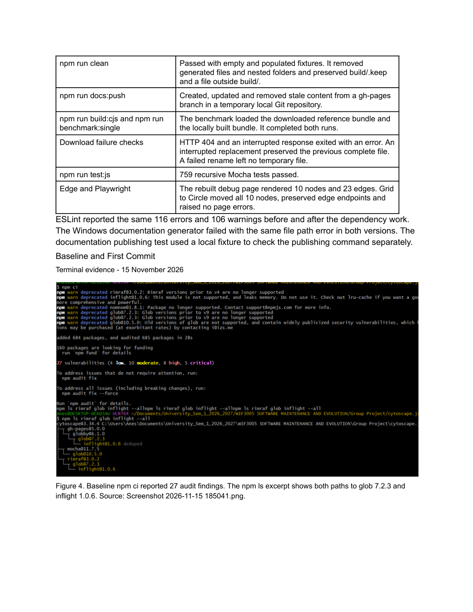

*Figure 1. PDF page 16: baseline dependency-tree screenshot and documented command checks. The 27 baseline findings are not the final result.*

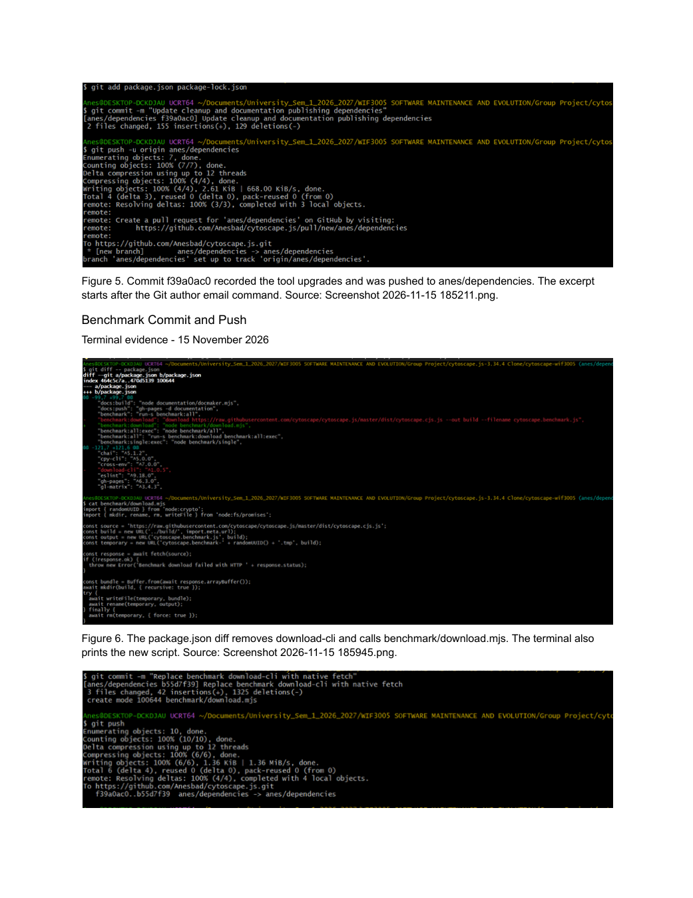

*Figure 2. PDF page 17: screenshots documenting the tool-upgrade commit, downloader change and push. The report separately records the final audit total as 21; this page is not proof that all findings were resolved.*

### Rank 2 — Keertti: Grid layout validation

**Changed locations:** `src/extensions/layout/grid.mjs`, `test/layout-grid.mjs`.  
**Change references:** [PR #2 — Files changed](https://github.com/Anesbad/cytoscape.js/pull/2/files), [commit b13c33eee](https://github.com/Anesbad/cytoscape.js/commit/b13c33eee).

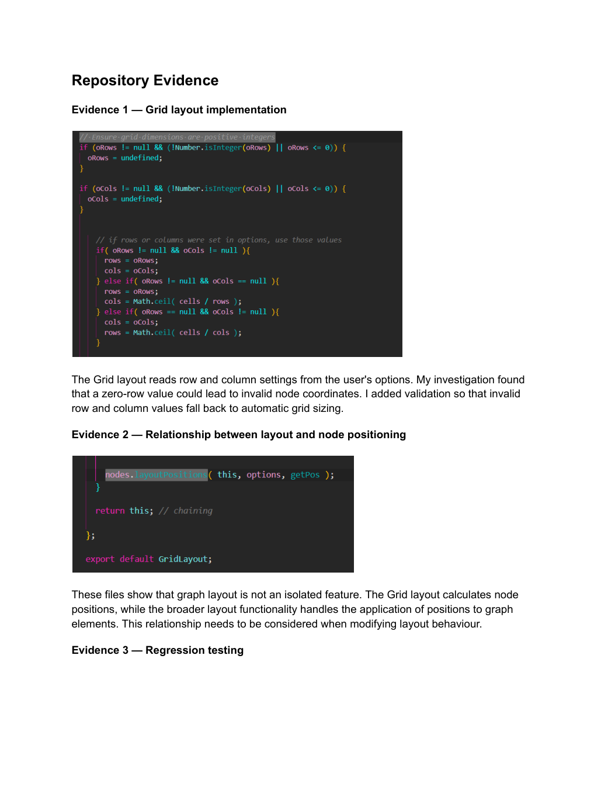

*Figure 3. PDF page 64: source screenshots of the validation and layout-position dependency.*

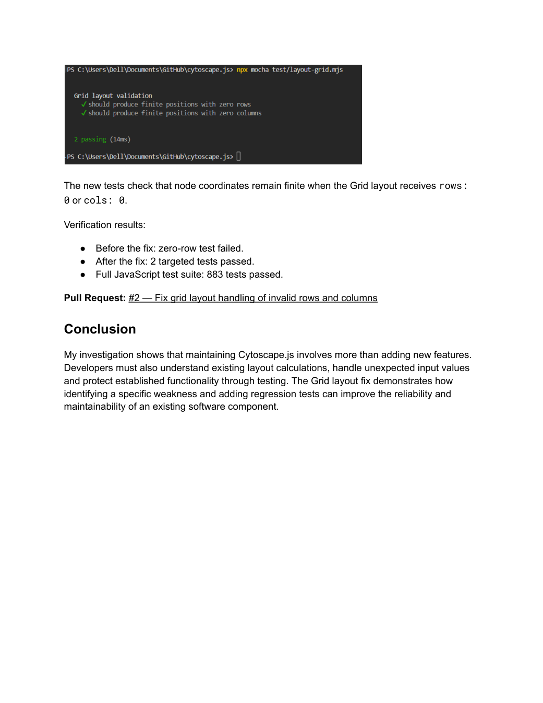

*Figure 4. PDF page 65: regression-test excerpt and author-reported before/after checks. The 883-test result needs its exact revision and command confirmed.*

### Rank 3 — Sanchay: CI runner compatibility

**Changed location:** `.github/workflows/tests.yml`, runner setting.  
**Change reference:** [PR #1 — Files changed](https://github.com/Anesbad/cytoscape.js/pull/1/files).

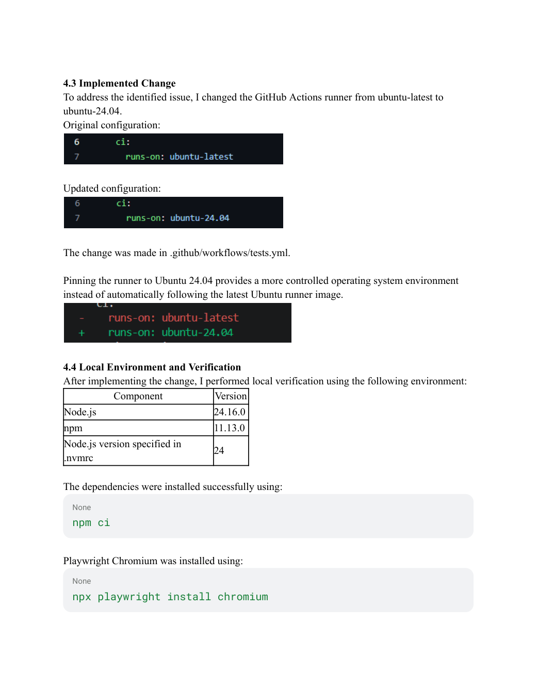

*Figure 5. PDF page 54: original and revised runner settings, with the author's local environment details.*

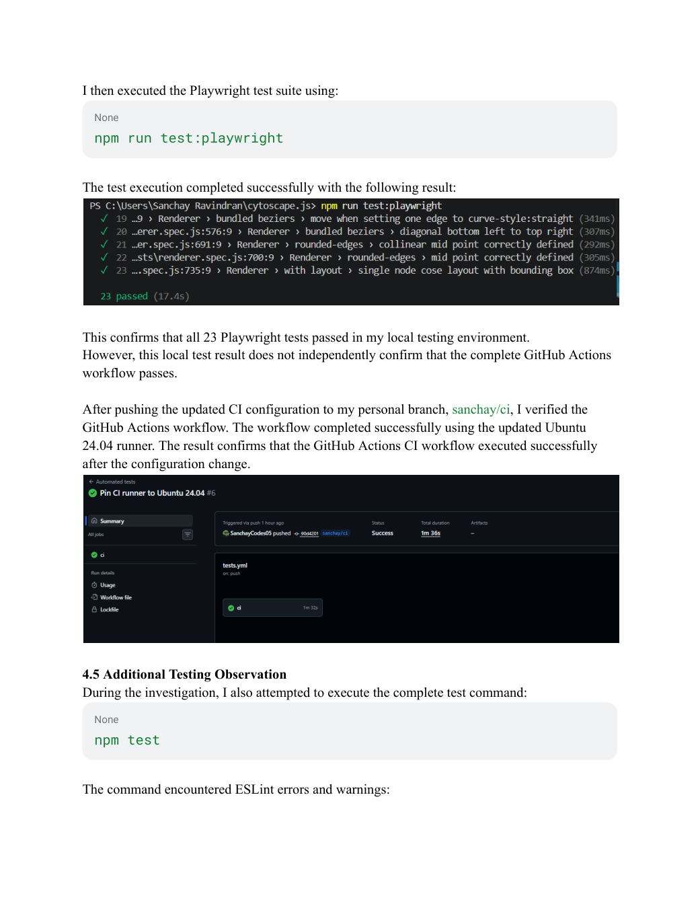

*Figure 6. PDF page 55: local Playwright results and a remote workflow screenshot. The local lint failure described in the report remains separate and unresolved in this compilation.*

### Rank 4 — Saufi: connected-edge regression coverage

**Changed location:** `test/collection-graph-manipulation.mjs`.  
**Change reference:** [PR #7 — Files changed](https://github.com/Anesbad/cytoscape.js/pull/7/files).

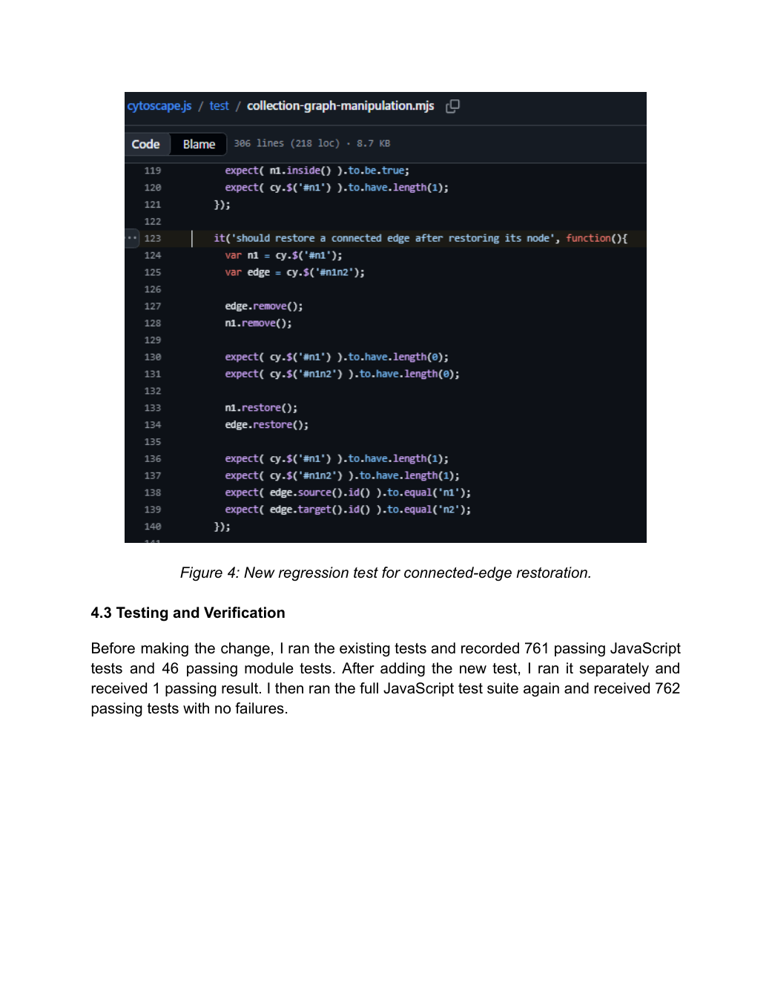

*Figure 7. PDF page 32: the added test restores the node and connected edge and checks endpoints.*

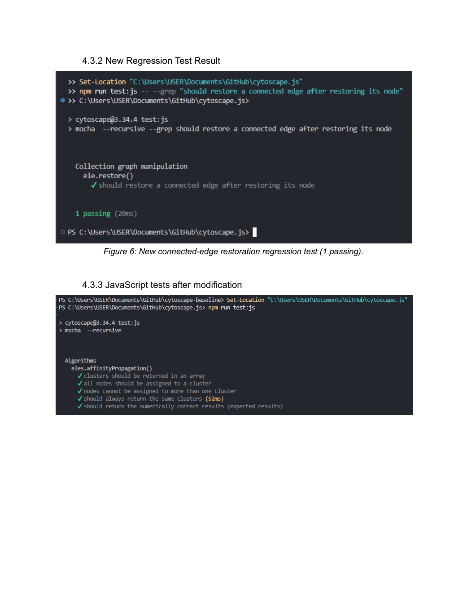

*Figure 8. PDF page 34: screenshots of the targeted check and subsequent JavaScript test run; the author's reported total changes from 761 to 762.*

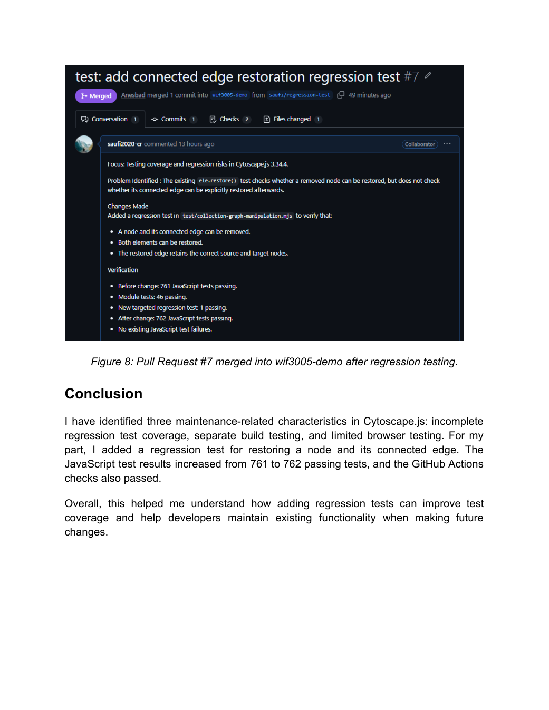

*Figure 9. PDF page 36: supplied PR screenshot and explanation reporting the merge. Current GitHub status has not been independently checked.*

### Rank 5 — Jasmine: Promise documentation

**Changed location:** comments before the final export in `src/promise.mjs`.  
**Exact diff:** pending the author's PR or commit link. [Source context](https://github.com/Anesbad/cytoscape.js/blob/wif3005-demo/src/promise.mjs) does not replace a diff.

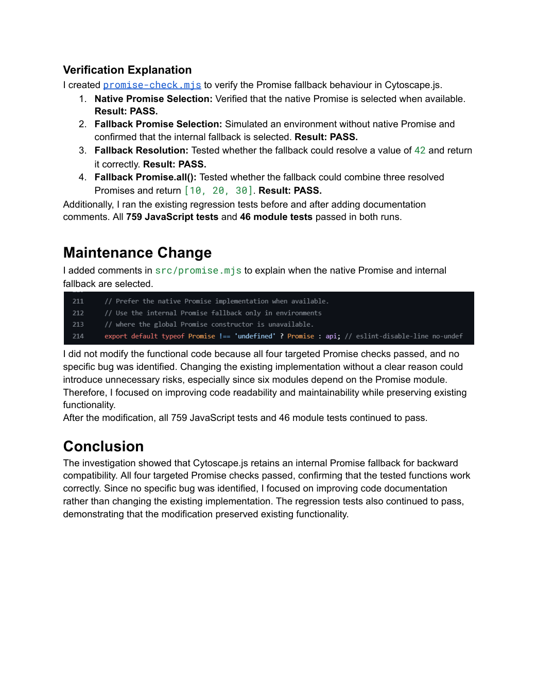

*Figure 10. PDF page 23: code screenshot of the documentation comments and written verification results. This page does not provide raw terminal screenshots for all reported checks.*

### Pending implementation — Yashveena: TypeScript declarations

**Investigated location:** `index.d.ts`, `CssStyleDeclaration` and `ElementDefinition.style`.  
**Exact diff:** not supplied. [Source context](https://github.com/Anesbad/cytoscape.js/blob/wif3005-demo/index.d.ts).

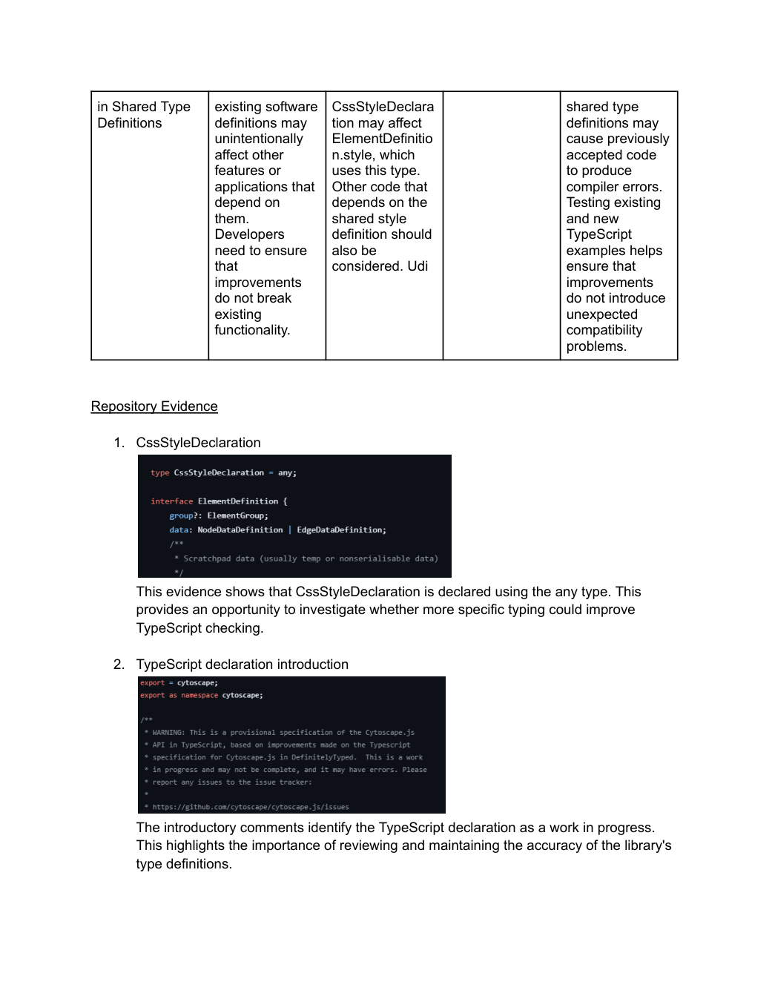

*Figure 11. PDF page 83: source evidence for the permissive declaration and introductory comments. This documents the investigation, not a completed improvement.*

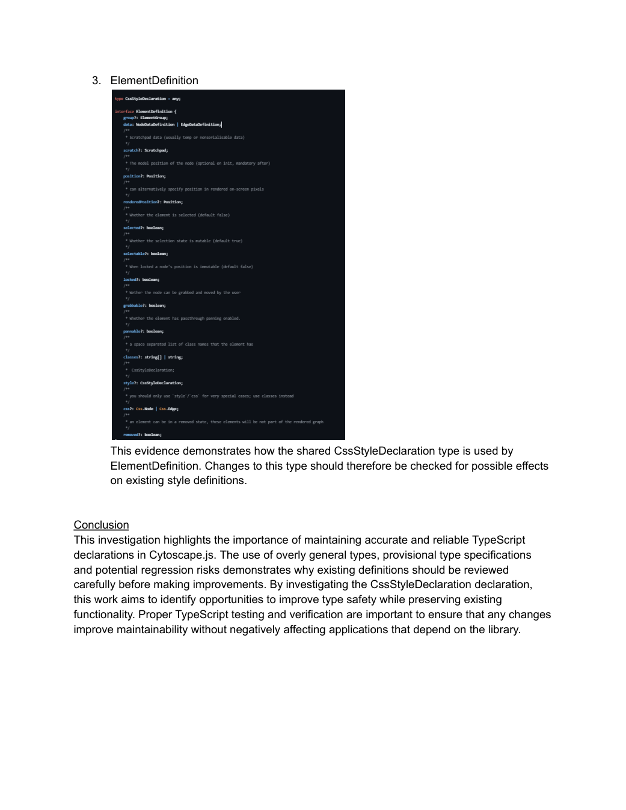

*Figure 12. PDF page 84: the dependent style definition. Before/after compiler screenshots and a change diff are still pending.*

## Outstanding Verification

Before finalising the repository summary, confirm:

- Group agreement on the five selected characteristics.
- Anes's and Jasmine's PR references and review status.
- Yashveena's compiler checks and PR reference, if completed.
- The revisions and commands associated with the different test totals.
- The exact remote CI run and revision supporting Sanchay's reported success, considered separately from his local lint failure.
- The final merged branch revision used for the presentation and rehearsal.

Repository branch links can change. Where possible, replace them with links to the exact commits used for the evidence.

## Conclusion

The combined findings support targeted, incremental maintenance of the investigated areas. Updating specific development tools, documenting compatibility behaviour, clarifying execution environments, strengthening regression coverage and improving type declarations can help maintain the project safely.

The evidence does not establish that Cytoscape.js needs a complete rewrite. Each finding should remain connected to its source, contributor, change and verification result so the group can explain both the improvement and its limits.
